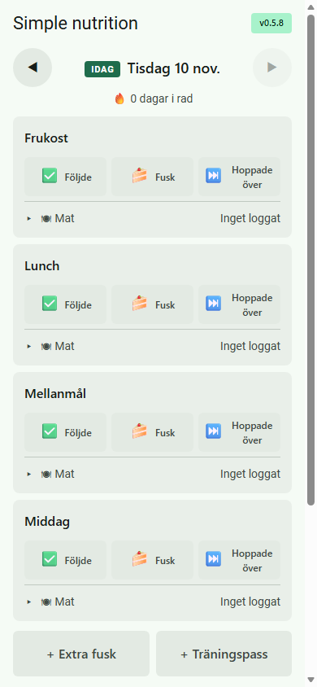
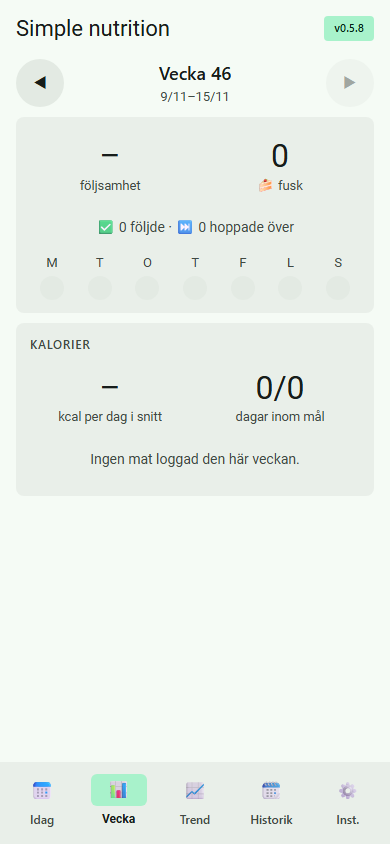
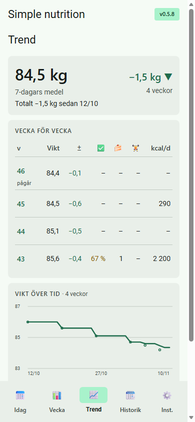

# Fitness buddy

**Calories and macros from plain ingredients – no account, no jungle of brands.**

### [▶ Open the app](https://flyinggooner.github.io/simple-nutrition/)

[📱 Presentation of the app](https://flyinggooner.github.io/simple-nutrition/docs/presentation.html) · [🛡️ Small apps, big needs](https://flyinggooner.github.io/simple-nutrition/docs/standard.html)

<!-- Screenshots: put them in docs/ and show them here -->

Made-up example data

## Why?

Calorie apps drown in duplicates and brand entries. Here there are only the Swedish Food Agency's ingredients, a few clear choices and your own recipes.

## Features

| | |
|---|---|
| 🔁 **Habits** | Tick off your habits every day and see how often you succeed. |
| 🏋️ **Training** | Log gym and cardio sessions against a weekly goal. |
| 🥕 **Food and calories** | The Swedish Food Agency's ingredients with kcal, protein, carbs and fat – in grams or measures. |
| 🍲 **Dishes** | Common ready dishes and product types (pizza, kebab, sushi, meatballs …) checked against package values, plus your own recipes and lunch boxes. |
| ⚡ **Quick picks** | When you do not know exactly: Breakfast, Home-made and Eating out in three levels, or your own estimate (e.g. from your phone's AI). |
| 🏷️ **Own products** | Add your own foods and search words. |
| ⚖️ **Weight** | Weight trend with a 7-day average. |
| 📊 **Week, Trend, History** | How the week and the period are going against the goal. |
| 🌍 **Language** | English or Swedish, chosen at the first start and changeable in Settings. Food names and search work in both. |
| 💾 **Backup** | Password-encrypted backup file with a password generator and reminder; move from Follow the plan. |
| ❓ **Help** | Manual right in the app, in both languages. |
| 📴 **Offline** | Works without network after the first visit. |
| ↩️ **Back** | The phone's back button closes what is open and goes back through the tabs you have visited. |
| 🌗 **Theme** | Light and dark, follows the phone's setting. |

## Why your data is safer here 🛡️

This app holds your weight, your habits and everything you eat. Here is why that is safer than in a typical app:

**Hacked company database** – the most common way sensitive data leaks

- Typical app with an account: Your data sits in a database with millions of others – a prime target
- **This app:** There is no database. Your data is only in your phone, so an attacker would have to get into *your* phone

**Your data is sold or shared**

- Typical app with an account: Common in free apps, and many paid ones share with partners for ads and analytics
- **This app:** No account, no analytics, no ads, no trackers – and the browser technically blocks every request out

**Employees or partners read it**

- Typical app with an account: Possible – the company holds the data
- **This app:** Nobody but you has it

**The company shuts down or is sold**

- Typical app with an account: Your data goes with it
- **This app:** The app and your data stay on your phone

**Backup in the cloud**

- Typical app with an account: Readable by the company
- **This app:** Encrypted with AES-256 and your password before it leaves the phone

**Is it the safest possible way?** For personal data like this, keeping it only on your own device, with no server and an encrypted backup, is as safe as a practical app gets – there is simply nothing central to steal. It is not magic, though: your phone itself must be locked and kept updated, the backup password must be strong, and you trust that the code served from GitHub Pages is the published, reviewed code (it is all open on GitHub for anyone to check).

## Privacy and security 🔒

- **No account, no cookies.** Everything is stored only in your browser (`localStorage`).
- **Nothing from outside.** No analytics, no ads, no fonts or scripts from outside – also blocked technically with a Content Security Policy.
- **Encrypted backup.** The backup file is always encrypted with a password you choose: AES-GCM 256 bits, and the key is derived with PBKDF2-SHA256 and 600,000 iterations – the level OWASP recommends and the same as the default in the password manager Bitwarden. A new salt and IV every time, and a file that has been changed cannot be restored. Only the browser's built-in crypto is used, no libraries from outside.

### Compared with typical calorie apps

| | This app | Typical calorie apps |
|---|---|---|
| Account | None | Required, often with email |
| Where the data is | Only in your phone | On the company's servers |
| Analytics, ads, trackers | None – blocked technically | Common |
| Backup | Encrypted file only your password opens | In the company's cloud |
| If the service shuts down | The app and the data remain | The data may disappear |

> **Honest about the limits:** the data in the phone is protected by the phone's own lock, not by separate encryption – lock your phone. A forgotten password cannot be recovered, and a weak password can be guessed, so choose a long one. If you clear site data everything disappears, so save a backup file now and then (Settings → Data).

### Security tested ✅

Automatic tests run before every new version and every upload. Failed test = no release.

**Security check**
- [x] **Only the app's own code runs** – the browser blocks everything else.
- [x] **Nothing leaves the phone** – the app never talks to any server.
- [x] **Your data stays with you** – stored only in the phone; the app only touches its own data.
- [x] **Works offline** – with only the app's own files.
- [x] **Locked backup** – only your password opens the file. The password is never stored in the file.

**Function tests**
- [x] **Broken files are stopped** – a backup from the wrong app, or one someone has changed, is not restored.
- [x] **No content can become code** – everything is shown as plain text.
- [x] **Backup round trip** – what you save is exactly what you get back.
- [x] **The food data** – over 100 dishes are recalculated against the answer key at every release.

## Install on your phone

**Android (Chrome)**
1. Open [the app](https://flyinggooner.github.io/simple-nutrition/) in Chrome.
2. Tap the menu **⋮** → **Install app** (or *Add to Home screen*).

**iPhone (Safari)**
1. Open [the app](https://flyinggooner.github.io/simple-nutrition/) in Safari.
2. Tap **Share** → **Add to Home Screen**.

The version number is shown at the top right of the app. New versions are fetched automatically.

## For developers

Plain HTML, CSS and JavaScript – no frameworks, no dependencies, no build step for the app.

**Run locally:** serve the folder statically, e.g. `python3 -m http.server 8080`, and open http://localhost:8080 (the service worker needs `localhost` or HTTPS).

**Test file:** `tools\build-single.ps1` bakes the app into a single file, `dist/simple-nutrition.html`, which can be opened directly in the browser or sent to someone.

| File | Contents |
|---|---|
| `index.html` | The app's markup |
| `styles.css`, `app.js`, `ui.js`, `nav.js`, `views/` | Style, router and clicks, shared state, Back logic, one file per view (ES modules) |
| `store.js` | Storage in `localStorage` and validation of saved data |
| `i18n.js`, `i18n-en.js` | Language support: the source text is Swedish; `i18n.js` (shared by all apps) translates what is drawn with the dictionary in `i18n-en.js` |
| `version.js` | Version number (single source) |
| `sw.js`, `manifest.webmanifest`, `icons/` | Installation as an app (PWA) and offline |
| `docs/SPEC.md` | Specification of features and behaviour |
| `docs/DATA.md` | The data format of the backup file (same as readme/schema/example in the file) |
| `docs/MANUAL.md`, `docs/MANUAL.en.md` | The manual in Swedish and English (Help in the app is built from them) |
| `docs/presentation.html` | Stand-alone mobile presentation of the app (Swedish by default, English with the button on the first slide) |
| `docs/standard.html` | Small apps, big needs – what all the apps have in common (synced from the template) |
| `tools/build-single.ps1` | Builds the test file |
| `tools/tests/` | Unit and flow tests (run in headless Edge, automatically before every release and push) |
| `CLAUDE.md` | Rules for development |

Published to GitHub Pages from `master`.
