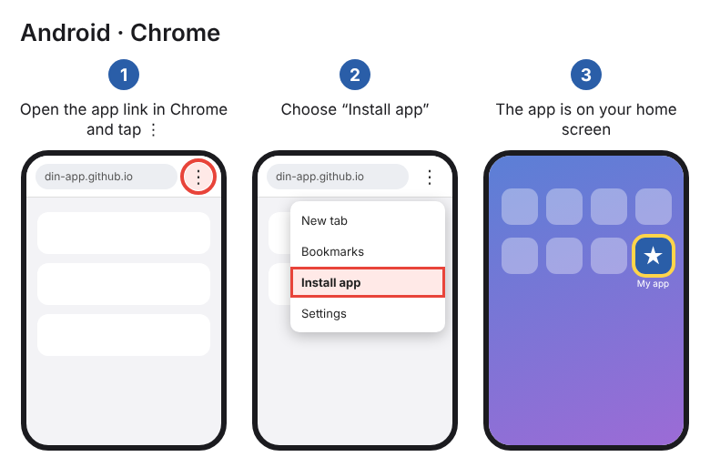
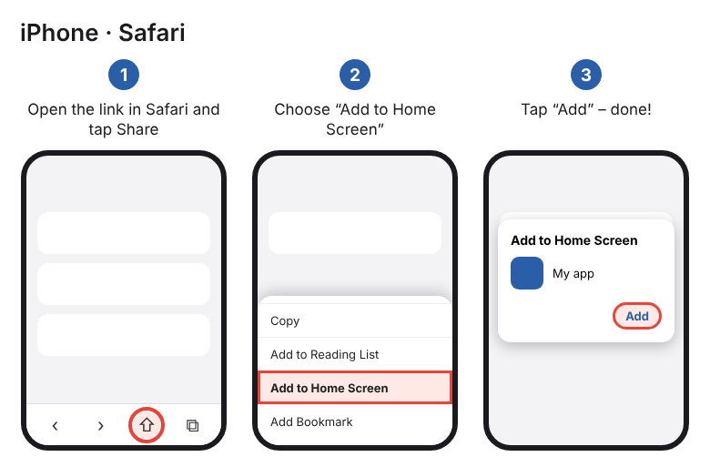

# Fitness buddy – how to use the app

The same text is in the app under **Settings → General → Help and manual** when English is chosen. Help is built from this file with `tools/build-help.ps1` – edit only here (Swedish: `MANUAL.md`).

## Get started
- Habits come first: tap ✅ On plan, 🍰 Cheat or ⏭️ Skipped for each meal in Today. Calories are a support when you want to count your basic meals.
- Under **Settings → Habits** you write your plan (shown at the top of Today), set the limit for a successful day and change meals and reasons.
- Moving from Follow the plan: see **Move from Follow the plan** below.

## Why your data is safe here
- This app holds your weight, habits, what you eat and how often you cheat. That should not end up with a company, an advertiser or a hacker.
- **No server to hack.** Most big leaks happen when a company's database with millions of users' data is hacked. There is no such database here: your data is only in your phone. Anyone who wants it has to get into your particular phone.
- **Nothing to sell.** Many free apps – and paid ones too – make money from your data or share it with partners for ads and analytics. This app has no account, no analytics, no ads and no trackers. The browser also technically blocks every request out, so the data cannot be sent anywhere, not even by mistake.
- **Locked backup.** The backup file is encrypted with AES-256 and your password. If you put it in the cloud, the cloud service only sees unreadable data.
- **Open code.** All the code is public on GitHub and can be reviewed by anyone.
- **Honestly: nothing is 100 % safe.** What remains is your own phone – lock it with a code and keep it updated – a weak backup password, and that the app's code on GitHub Pages is not changed by someone unauthorised. But for this kind of data there is no safer practical way than never letting it leave the phone.

## Habits
- Tap the outcome for the meal. Tap the same one again to remove it.
- With 🍰 Cheat: choose a reason (e.g. Eating out or Craving) and add a short note if you like. With Snacks or Eating out you can choose how much (e.g. A little ≈ 250, a Magnum) – the kcal are then logged in the meal. Tap again to remove.
- Filled-in meals are folded into one line (choice, dish and kcal) – tap the line to change it. 🍰 Cheat without a reason stays open until a reason is chosen.
- **+ Extra cheat** logs snacks between meals. Choose how much right away: A little ≈ 250 · Medium ≈ 500 · A lot ≈ 950 – it is saved and the card folds. To enter exactly what it was, tap **+ Choose food or dish** and pick from the same menu as for food (e.g. crisps or a cinnamon bun). Tap the line to change it.
- Adherence = followed meals divided by followed + cheats. Skipped does not count. A day is successful when it reaches your limit (80 % to start with). 🔥 shows successful days in a row.

## Training
- Tap **+ Workout** and choose a type. Push, Pull and Legs can be combined – Push + Pull counts as one session. Running and Intervals are logged with distance (km) and time (e.g. 28:30).
- A saved workout is shown as a line. Tap it to delete the workout.
- Under **Settings → Training** you change the workout types and set goals per week. The goals show on the button in Today and in Week.

## Food and calories
- Tap the calorie card at the top of Today to see **everything you ate today**: one row per food or dish with amount, meals, kcal and protein/carbs/fat. The same thing from several meals is merged, e.g. *Protein pudding ×2 · breakfast, snack*. A dish (▾) unfolds to its ingredients with the amount and kcal you ate. **📋 Copy to check with AI** at the bottom shares the day as text (or copies it) – paste it into e.g. Gemini, and it works out the same day and compares with the app's numbers.
- Under each meal there is a folded line **🍽 Food**. Open it and tap **+ Add food**. When food is logged the line shows **✅ Food** and the meal's kcal for the day.
- Swipe left or right to switch between **Recent**, **Foods**, **Dishes** and **Quick picks**.
- Under **Foods** you search, e.g. milk. Choose a variant (Light, Medium …) and an amount. The natural unit is preselected (pc, slice, piece or dl); solid foods can also be entered in grams and drinks in dl or ml. If you change unit the number is converted, and the line shows e.g. "2 pc (90 g) · 150 kcal". Measures are approximate. Show more searches the whole Swedish Food Agency list (names in Swedish).
- If you have eaten the food or dish before, the amount is already filled in with what you chose last time (shown under Last time) – usually it is enough to tap Add.
- **Quick picks:** when you do not know exactly. Home-made: Light ≈ 450, Standard ≈ 650, Heavy ≈ 850 kcal. Eating out: Light ≈ 700, Standard ≈ 1,000, Heavy ≈ 1,400 kcal. Breakfast: Light ≈ 250, Standard ≈ 400, Heavy ≈ 650 kcal. One tap logs it. If you pick Light when eating out the meal can still be ✅ on plan – you decide. Own estimate: fill in kcal, and preferably protein, carbs and fat, when you already know roughly what the dish contains. It is saved under Recent. Tip: photograph the plate and ask the AI on your phone (e.g. Gemini or Apple Intelligence) to estimate the values. It is never exact from a photo, but often close enough – and closer than a standard estimate, since it is about your plate.
- **Standard estimates:** common foods and dishes have an approximate value. Enter a number or a weight. If you want exact values, add the food under Own products.
- **can drained** means drained weight: a can of kidney beans is 400 g with liquid but about 230 g beans – it is the beans that count.
- Under **Recent** you log something you have eaten before with one tap. **Copy yesterday's food** fills an empty day with yesterday's food.
- **Select several:** hold your finger on a food entry until it is selected and tap more. **Copy** adds them to another day (same meal and amount), **Delete** removes them. Undo is available right afterwards. ✕ or Back ends.
- Tap an entry to change the amount, move it to another meal or delete it.
- There is no calorie goal to start with – the app just shows the day's total. If you want a goal, set it under **Settings → Calories → Calorie goal** (empty = no goal), and likewise optional goals for protein and carbs.

## Dishes
- Build your own dishes under **Settings → Calories → My dishes → + New dish**. Add the ingredients in grams (raw weight).
- Choose **Per portion** if the recipe is for one portion, or **Whole batch** and the number of portions, e.g. bolognese with 500 g beef mince split into 5.
- Ideally weigh the whole cooked dish and fill in the **cooked weight** – then you can log in grams, which is most exact.
- Log under **Add food → Dishes**: portions (½, 1, 2 …), share of the batch (e.g. 1/5) or grams of the cooked dish.
- **Save a meal as a dish:** open 🍽 Food and tap **+🍲 Save as dish**, e.g. breakfast with 100 g yoghurt and 100 g granola. Give the dish a name and save.
- If you change a dish later, days already logged are not affected.

## Own products and search words
- If a food is missing: add it under **Own products** with kcal, protein, carbs and fat per 100 g from the package, and preferably a measure (e.g. 1 pc = 40 g).
- Edit a product with ✎. Days already logged are not affected.
- If the search does not find what you mean: choose the food and tap **Save your own search word**. The word then shows that food first.

## Change day
- Use ◀ ▶ or swipe left/right. Tap the date, ↩ Back to today or the Today tab to go back to today.
- Back closes what is open (Add, a dish, a dialog) and then goes back through the tabs you have visited. The app closes only where you started. Back does not change day.
- 🗑 Clear the day removes the day's habits, food, workouts and weight. Undo is available for a few seconds afterwards.

## Weight
- Enter your weight under **Weight today**, ideally in the morning. The trend uses a 7-day average, so single days matter little.

## Week, Trend and History
- **Week:** the weight (latest weigh-in vs the first weigh-in the week before, with a mini curve), adherence, cheats and most common reason, day by day (habits, workouts, kcal, weight – tap to open the day), training against the goals and calorie average. Bars per day are shown only when a calorie goal is set.
- **Trend:** the weight (7-day average), the change over the last 4 weeks and the weight curve in one card, a table week by week (weight, adherence, cheats, workouts, kcal – tap to open the week) and what goes together: good vs worse weeks, training and calories (after 4 weeks).
- **History:** the weight this month vs the latest weigh-in the month before (with a mini curve), adherence over 7 and 30 days and streaks in one card, then the month calendar coloured by adherence with marks for weigh-ins and training, and last workouts in total and kcal average.
- Week compares single weigh-ins, Trend 7-day averages.

## Card order
- Under **Settings → Appearance → Card order** you choose the order of the cards in Today, Week, Trend and History. ↑ ↓ moves, ● shown, ○ hidden. **Reset** restores the default order, for one view or for all views at the bottom.

## Language and units
- The app starts in Swedish. Change the language under **Settings → General → Language**. Your data is the same in both languages.
- **Units:** metric (g, dl, kg, km) or imperial (oz, cup, fl oz, lb, mi). Metric is preselected; change it under **Settings → General → Language and units**. Only the display changes; everything is stored as before. Tablespoons, teaspoons and pieces are the same in both.
- Food names from the Swedish Food Agency's full list (Show more) are in Swedish; the common foods, quick picks and the whole app are translated.

## Move from Follow the plan
- Open Follow the plan → Settings → Data → **Save backup file**.
- Open Fitness buddy → Settings → General → Data → **Restore backup file** and choose the file (or paste the file's contents under Paste text).
- Check the summary and tap **Add**. Habits, reasons, notes, weigh-ins, workouts, plan and goals come along. Meals with the same name are merged. Nothing you already have in Fitness buddy is removed – Undo is available right afterwards.

## Backup and moving
- Under **Data**: tap **Save backup file**. The file is called e.g. simple-nutrition-2026-11-09.txt and ends up among your downloads.
- The app reminds you to back up every month (or week). Change it under **Data → Backup reminder**.
- To restore: tap **Restore backup file**, check the summary and tap **Replace**. All current data is replaced – Undo is available right afterwards.
- If you cannot choose the file: open **Paste text** and paste the file's contents.
- The file contains all your data and is always locked with your code (see below).
- The backup file is always locked with **your code**: 16 random characters the app creates for you the first time it starts and stores on the device. If you would rather use your own code (e.g. the same in all your apps), tap **Choose your own code** – it needs at least 16 characters with upper and lower case, a digit and a special character, the same requirements as the created one. A backup takes one tap. Under Settings → Data you find Your code: **Show**, **Copy** and **New code**. Save the code in your password manager – on a new phone (or after Delete all data) you need it to open a backup. If you restore a backup with a different code, that code is used for new backups from then on. New code means old backup files open only with the old code (Undo is available). The app collects no data – the code is just a key that protects your backups.
- The file describes its own format and has an example, so it can be edited by hand and restored again.

## Install as an app

- **Android (Chrome):** open the app link, tap ⋮ at the top right and choose **Install app**.

- **iPhone (Safari):** open the link in Safari, tap **Share** (the box with the arrow) and choose **Add to Home Screen** → **Add**.
- Installed, the app works like a normal app, even offline.

## Privacy and source
- The app makes no requests – no server, no analytics, no account. All data is only in this browser.
- The nutrition values come from the Swedish Food Agency's food database and are built into the app.
