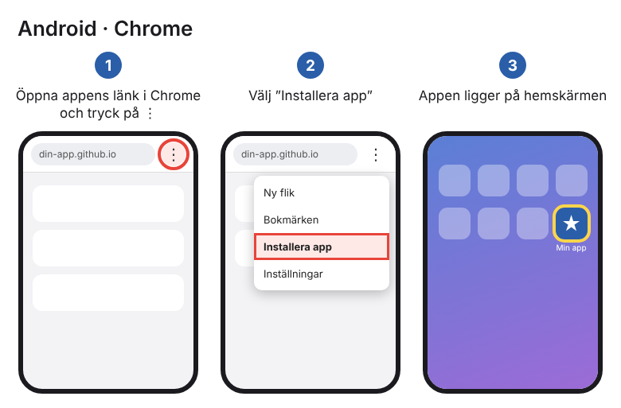
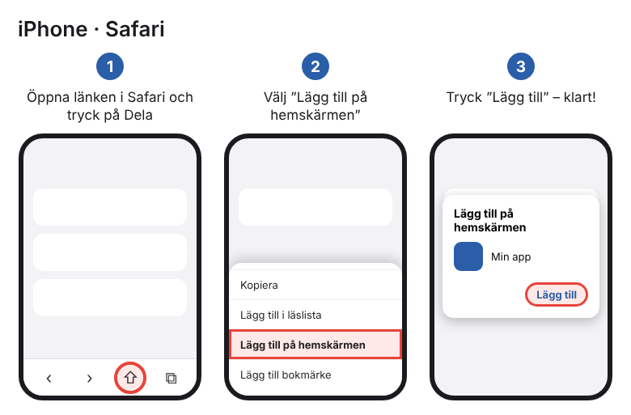

# Fitness buddy – så använder du appen

Samma text finns i appen under **Inställningar → Allmänt → Hjälp och manual**. Hjälp byggs från den här filen med `tools/build-help.ps1` – ändra bara här.

## Kom igång
- Vanorna är huvudsaken: tryck ✅ Enligt plan, 🍰 Fusk eller ⏭️ Hoppade över på varje måltid i Idag. Kalorierna är ett stöd när du vill räkna på dina basmåltider.
- Under **Inställningar → Vanor** skriver du din plan (visas överst i Idag), sätter gränsen för en lyckad dag och ändrar måltider och orsaker.
- Flyttar du från Följ planen: se **Flytta från Följ planen** nedan.

## Varför din data är säker här
- Här finns vikt, vanor, vad du äter och hur ofta du fuskar. Sådant ska inte hamna hos ett företag, en annonsör eller en hackare.
- **Ingen server att hacka.** De flesta stora läckor sker när ett företags databas med miljontals användares uppgifter hackas. Här finns ingen sådan databas: din data finns bara i din telefon. Den som vill åt den måste komma åt just din telefon.
- **Inget att sälja.** Många gratisappar – och även betalappar – tjänar pengar på din data eller delar den med partner för annonser och analys. Den här appen har inget konto, ingen analys, ingen reklam och inga spårare. Webbläsaren spärrar dessutom tekniskt alla anrop ut, så datan kan inte skickas iväg ens av misstag.
- **Låst backup.** Backup-filen krypteras med AES-256 och ditt lösenord. Lägger du den i molnet ser molntjänsten bara obegriplig data.
- **Öppen kod.** All kod ligger öppet på GitHub och kan granskas av vem som helst.
- **Ärligt: inget är 100 % säkert.** Det som återstår är din egen telefon – lås den med kod och håll den uppdaterad – ett svagt backup-lösenord, och att appens kod på GitHub Pages inte ändras av någon obehörig. Men för den här sortens uppgifter finns inget säkrare praktiskt sätt än att de aldrig lämnar telefonen.

## Vanor
- Tryck på utfallet för måltiden. Tryck igen på samma för att ta bort det.
- Vid 🍰 Fusk: välj en orsak (t.ex. Utemat eller Sug) och skriv gärna en kort anteckning. Vid Snacks eller Utemat kan du välja hur mycket (t.ex. Lite ≈ 250, en Magnum) – då loggas kcal i måltiden. Tryck igen för att ta bort.
- Ifyllda måltider visas hopfällda som en rad (val, rätt och kcal) – tryck på raden för att ändra. 🍰 Fusk utan orsak hålls öppen tills orsaken är vald.
- **+ Extra fusk** loggar snacks mellan måltiderna. Välj direkt hur mycket: Lite ≈ 250 · Mellan ≈ 500 · Mycket ≈ 950 – då sparas det och kortet fälls ihop. Vill du ange exakt vad det var trycker du på **+ Välj vara eller rätt** och väljer i samma meny som för mat (t.ex. chips eller en kanelbulle). Tryck på raden för att ändra.
- Följsamhet = följda måltider delat med följda + fusk. Hoppade över räknas inte. En dag är lyckad när den når din gräns (80 % från start). 🔥 visar lyckade dagar i rad.

## Träning
- Tryck **+ Träningspass** och välj typ. Push, Pull och Ben kan kombineras – Push + Pull räknas som ett pass. Löpning och Intervaller loggas med sträcka (km) och tid (t.ex. 28:30).
- Ett sparat pass visas som en rad. Tryck på den för att ta bort passet.
- Under **Inställningar → Träning** ändrar du passtyperna och sätter mål per vecka. Målen syns på knappen i Idag och i Vecka.

## Mat och kalorier
- Tryck på kalorikortet överst i Idag för att se **allt du ätit i dag**: en rad per vara eller rätt med mängd, måltider, kcal och protein/kolhydrater/fett. Samma sak från flera måltider slås ihop, t.ex. *Proteinpudding ×2 · frukost, mellanmål*. En rätt (▾) fälls ut till sina ingredienser med mängd och kcal för det du ätit. **📋 Kopiera för kontroll med AI** längst ner delar dagen som text (eller kopierar den) – klistra in i t.ex. Gemini, så räknar den på samma dag och jämför med appens siffror.
- Under varje måltid finns en hopfälld rad **🍽 Mat**. Fäll ut den och tryck **+ Lägg till mat**. När mat är loggad visar raden **✅ Mat** och dagens kcal för måltiden.
- Svep åt vänster eller höger för att byta mellan **Senaste**, **Varor**, **Rätter** och **Snabbval**.
- Under **Varor** söker du, t.ex. mjölk. Välj variant (Lätt, Mellan …) och mängd. Den naturliga enheten är förvald (st, skiva, bit eller dl); fasta varor kan också anges i gram och drycker i dl eller ml. Byter du enhet räknas talet om, och raden visar t.ex. "2 st (90 g) · 150 kcal". Mått är ungefärliga. Visa fler söker i hela Livsmedelsverkets lista.
- Har du ätit varan eller rätten förut är mängden redan ifylld med det du valde senast (står under Senast) – oftast räcker det att trycka Lägg till.
- **Snabbval:** när du inte vet exakt. Hemmagjort: Lätt ≈ 450, Standard ≈ 650, Tung ≈ 850 kcal. Utemat: Lätt ≈ 700, Standard ≈ 1 000, Tung ≈ 1 400 kcal. Frukost: Lätt ≈ 250, Standard ≈ 400, Tung ≈ 650 kcal. Ett tryck loggar. Tar du Lätt när du äter ute kan måltiden ändå vara ✅ enligt plan – du väljer själv. Egen uppskattning: fyll i kcal, och gärna protein, kolhydrater och fett, när du redan vet ungefär vad rätten innehåller. Den sparas under Senaste. Tips: fotografera tallriken och be AI:n i telefonen (t.ex. Gemini eller Apple Intelligence) uppskatta värdena. Det blir aldrig exakt från en bild, men ofta nära nog – och närmare än en schablon, eftersom det gäller just din tallrik.
- **Schabloner:** vanliga varor och rätter har ett ungefärligt värde. Ange antal eller vikt. Vill du ha exakta värden lägger du in varan under Egna produkter.
- **burk avr.** betyder avrunnen vikt: en burk kidneybönor är 400 g med spad men ca 230 g bönor – det är bönorna som räknas.
- Under **Senaste** loggar du något du ätit förut med ett tryck. **Kopiera maten från igår** fyller en tom dag med gårdagens mat.
- **Markera flera:** håll fingret på en matpost tills den blir markerad och tryck på fler. **Kopiera** lägger in dem på en annan dag (samma måltid och mängd), **Radera** tar bort dem. Ångra finns direkt efteråt. ✕ eller Bakåt avslutar.
- Tryck på en post för att ändra mängd, flytta den till en annan måltid eller ta bort den.
- Det finns inget kalorimål från start – appen visar bara dagens summa. Vill du ha ett mål sätter du det under **Inställningar → Kalorier → Kalorimål** (tomt = inget mål), och likaså valfria mål för protein och kolhydrater.

## Rätter
- Bygg dina egna rätter under **Inställningar → Kalorier → Mina rätter → + Ny rätt**. Lägg till ingredienserna i gram (råvikt).
- Välj **Per portion** om receptet gäller en portion, eller **Hel sats** och antal portioner, t.ex. köttfärssås på 500 g nötfärs delat på 5.
- Väg gärna hela den färdiga rätten och fyll i **färdig vikt** – då kan du logga i gram, det blir exaktast.
- Logga under **Lägg till mat → Rätter**: portioner (½, 1, 2 …), andel av satsen (t.ex. 1/5) eller gram av färdig rätt.
- **Spara en måltid som rätt:** fäll ut 🍽 Mat och tryck **+🍲 Spara som rätt**, t.ex. frukost med 100 g yoghurt och 100 g granola. Ge rätten ett namn och spara.
- Ändrar du en rätt senare påverkas inte dagar som redan är loggade.

## Egna produkter och sökord
- Saknas en vara: lägg in den under **Egna produkter** med kcal, protein, kolhydrater och fett per 100 g från förpackningen, och gärna ett mått (t.ex. 1 st = 40 g).
- Ändra en produkt med ✎. Dagar som redan är loggade påverkas inte.
- Hittar sökningen inte det du menar: välj varan och tryck **Spara eget sökord**. Ordet visar sedan varan först.

## Byta dag
- Använd ◀ ▶ eller svep åt vänster/höger. Tryck på datumet, ↩ Till idag eller fliken Idag för att gå tillbaka till idag.
- Bakåt stänger det som är öppet (Lägg till, en rätt, en dialog) och går sedan tillbaka genom flikarna du besökt. Appen stängs först där du började. Bakåt byter inte dag.
- 🗑 Rensa dagen tar bort dagens vanor, mat, pass och vikt. Ångra finns några sekunder efteråt.

## Vikt
- Fyll i vikten under **Vikt idag**, gärna på morgonen. Trenden räknas på 7-dagars medel, så enskilda dagar spelar liten roll.
- **Viktmål:** under **Inställningar → Kalorier → Viktmål** fyller du i **målvikt**, **takt** (gå ner per vecka) eller båda, t.ex. 95 kg i 0,5 kg/vecka. Takten anges i kg eller i procent av vikten (procent följer vikten när den sjunker). Med målvikt kan du i stället för takt välja ett datum. Utan takt och datum räknas kaloriråden på 0,5 % i veckan, och prognosen visar när du når målet. Takten får vara högst 1 % av din vikt per vecka (vid 80 kg alltså 0,8 kg). Gränsen räknar med att vikten sjunker, så 1 % blir lite mindre för varje vecka. Är datumet för tidigt sparas målet inte, och appen säger vilket datum som är det tidigaste. Halkar du efter så att målet skulle kräva mer än 1 % i veckan flyttas datumet automatiskt till det tidigaste möjliga, och appen säger till. Målet, takten och takten de senaste 4 veckorna visas i Trend och i Vecka. **Prognosen** räknar ut från din faktiska vikttrend (senaste 4 veckorna, minst 4 vägningar under 10 dagar) när du sannolikt når målet, visar målets takt och ditt utfall i kg per vecka, och säger om du är ✅ i fas (inom en vecka), 🚀 före, ⚠️ efter eller om trenden går åt fel håll. Takten räknas också om till ungefär kcal per dag (1 kg ≈ 7 700 kcal).
- **Total förbrukning** (Trend): appen räknar ut hur mycket du gör av med per dag, från vad du loggat och hur vikten ändrats de senaste 4 veckorna. De 3 första dagarna efter att du började logga räknas inte, eftersom vikten då mest faller av vätska. Den räknas annars från första dagen men visas som ett intervall tills datan räcker. **Kvaliteten** (0–100 %) avgörs av datan själv: hur mycket vikten brusar, hur många dagar du loggat, om resultatet är rimligt och om veckorna stämmer med varandra. Loggar du all mat och väger dig minst 3 gånger i veckan når den 100 % efter 2–4 veckor; slarvar du sjunker den, och appen säger vad som drar ner. Med ett viktmål visas också ungefär hur mycket du ska äta per dag för takten.
- **Överst i Idag** står dagens kalorier mot målet och hur mycket som är kvar (ditt kalorimål om du satt ett, annars förbrukningen plus viktmålets takt). Viktmål, prognos och förbrukning finns under **Trend**.
- **Utan viktmål** visar Idag under dagens kalorier (när kvaliteten är minst 25 %) vad som håller vikten och knappar för att välja mål direkt: gå ner 0,25, 0,5 eller 1 kg eller 1 % per vecka (bara val som är högst 1 % av din vikt). Tryck på valt mål igen för att ta bort det.
- **Komplett dag:** bara kompletta dagar räknas i förbrukning och kalorisummor. En dag är komplett när varje måltid har mat eller är markerad ⏭️ Hoppade över, den har minst 800 kcal och är slut (idag räknas inte). ✅ eller 🍰 utan mat räcker inte – då har du ätit men inte loggat. Under **Inställningar → Vanor → Måltider** väljer du för varje måltid **Krävs** eller **Valfri**. En valfri måltid, t.ex. Mellanmål, behöver inte fyllas i. I Idag står **○ Fyll i** på krävda måltider som saknar mat och ⏭️, och **Valfri** på tomma valfria. Lägger du till en ny måltid krävs den bara från dagen du börjar använda den. Alla kalorisnitt i appen räknar bara kompletta dagar. Använd snabbvalen när du inte vet exakt. Idag säger vad som saknas, och i Vecka markeras dagar som inte räknas med ○ (dagar med vanor men utan mat visas som "ingen mat ○"). Har du inte vägt dig på 4 dagar påminner Idag om det.
- **Vecka:** viktkortet har ett diagram över förra och denna vecka: staplar för kcal per dag (ljusare = räknas inte), vikten som linje och en streckad linje för vad som håller vikten (och kalorimålet om du har ett). Kalorisnittet räknar bara kompletta dagar, och bredvid står hur många av dagarna med mat som var kompletta. Under kalorierna står veckans summa mot kalorimålet, mot förbrukningen och enligt vikten.
- **Kalorisumma:** Vecka och Historik (kortet Träning och kcal) visar veckans och månadens summa mot kalorimålet, mot förbrukningen och vad vikten säger (minus = underskott).

## Vecka, Trend och Historik
- **Vecka:** vikten (senaste vägningen mot första vägningen veckan innan, med minikurva), följsamhet, fusk och vanligaste orsak, dag för dag (vanor, pass, kcal, vikt – tryck för att öppna dagen), träning mot målen och kalorisnitt. Staplar per dag visas bara när ett kalorimål är satt.
- **Trend:** vikten (7-dagars medel) och förändringen senaste 4 veckorna, en större viktkurva, viktmålet med prognos och **Om trenden håller**: vikten om 1, 3 och 6 månader räknat på utfallet de senaste 4 veckorna (🎯 = målvikten nådd). Har du målvikt utan datum står det tydligt när du når den, t.ex. "🎯 100 kg ≈ 13 maj 2027". Kortet Total förbrukning visar förbrukningen och kcal för viktmålet bredvid varandra. Sedan en tabell vecka för vecka (vikt, följsamhet, fusk, pass, kcal – tryck för att öppna veckan).
- **Historik:** vikten i månaden mot senaste vägningen månaden innan (med minikurva) och följsamhet 7 och 30 dagar och streaks i samma kort, sedan månadskalendern färgad efter följsamhet med markering för vägning och träning, och sist månadens pass, kcal-snitt (kompletta dagar) och kalorisumma.
- Vecka jämför enskilda vägningar, Trend 7-dagars medel.

## Kortordning
- Under **Inställningar → Utseende → Kortordning** väljer du ordningen på korten i Idag, Vecka, Trend och Historik. ↑ ↓ flyttar, ● visas, ○ döljer. **Återställ** ger standardordningen tillbaka, för en vy eller för alla vyer längst ner.

## Språk och mått
- Appen är på svenska från början. Byt språk under **Inställningar → Allmänt → Språk**. Din data är densamma på båda språken.
- **Måttsystem:** metriskt (g, dl, kg, km) eller imperial (oz, cup, fl oz, lb, mi). Metriskt är förvalt; byt under **Inställningar → Allmänt → Språk och mått**. Bara visningen ändras; allt sparas som förut. Matskedar, teskedar och styck är desamma i båda.
- Livsmedelsnamn från Livsmedelsverkets hela lista (Visa fler) är alltid på svenska; vanliga varor, snabbval och hela appen är översatta.

## Flytta från Följ planen
- Öppna Följ planen → Inställningar → Data → **Spara backup-fil**.
- Öppna Fitness buddy → Inställningar → Allmänt → Data → **Läs in backup-fil** och välj filen (eller klistra in filens innehåll under Klistra in text).
- Kontrollera sammanfattningen och tryck **Lägg till**. Vanor, orsaker, anteckningar, vägningar, träningspass, plan och mål följer med. Måltider med samma namn slås ihop. Inget du redan har i Fitness buddy tas bort – Ångra finns direkt efteråt.

## Backup och flytt
- Under **Data**: tryck **Spara backup-fil**. Filen heter t.ex. simple-nutrition-2026-11-09.txt och hamnar bland hämtade filer.
- Appen påminner om backup varje månad (eller vecka). Ändra under **Data → Påminn om backup**.
- För att läsa tillbaka: tryck **Läs in backup-fil**, kontrollera sammanfattningen och tryck **Ersätt**. All nuvarande data ersätts – Ångra finns direkt efteråt.
- Går det inte att välja filen: öppna **Klistra in text** och klistra in filens innehåll.
- Filen innehåller all din data och låses alltid med din kod (se nedan).
- Backup-filen låses alltid med **din kod**: 16 slumpade tecken som appen skapar åt dig första gången den startas och sparar på enheten. Vill du hellre använda en egen kod (t.ex. samma i alla dina appar) trycker du **Välj egen kod** – den måste ha minst 16 tecken med stor och liten bokstav, siffra och specialtecken, samma krav som den skapade. Backup sparas med ett tryck. Under Inställningar → Data finns Din kod: **Visa**, **Kopiera** och **Ny kod**. Spara koden i din lösenordshanterare – på en ny telefon (eller efter Radera all data) behöver du den för att öppna en backup. Läser du in en backup med en annan kod används den koden sedan för nya backuper. Ny kod gör att gamla backup-filer bara öppnas med den gamla koden (Ångra finns). Appen samlar ingen data – koden är bara en nyckel som skyddar dina backuper.
- Filen beskriver sitt eget format och har ett exempel, så den går att ändra för hand och läsa in igen.

## Installera som app

- **Android (Chrome):** öppna appens länk, tryck ⋮ uppe till höger och välj **Installera app**.

- **iPhone (Safari):** öppna länken i Safari, tryck **Dela** (rutan med pilen) och välj **Lägg till på hemskärmen** → **Lägg till**.
- Installerad fungerar appen som en vanlig app, även utan nät.

## Integritet och källa
- Appen gör inga anrop – ingen server, ingen analys, inget konto. All data finns bara i den här webbläsaren.
- Näringsvärdena kommer från Livsmedelsverkets livsmedelsdatabas och finns inbyggda i appen.
